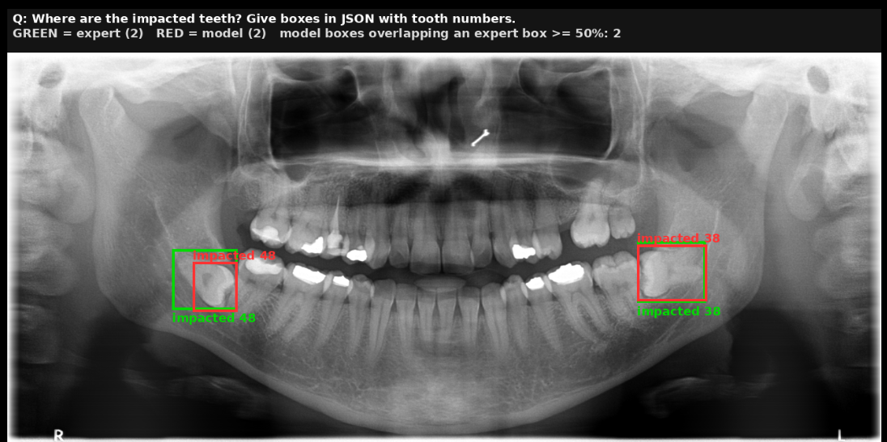
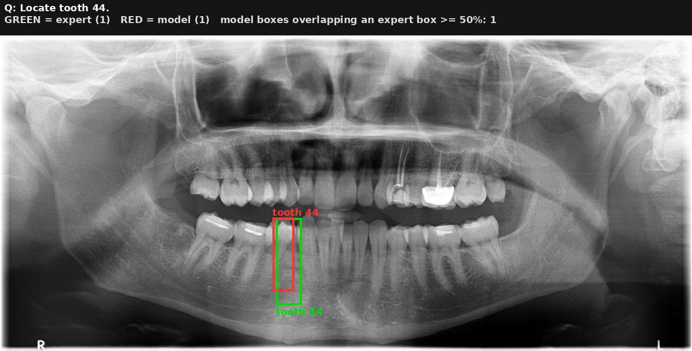
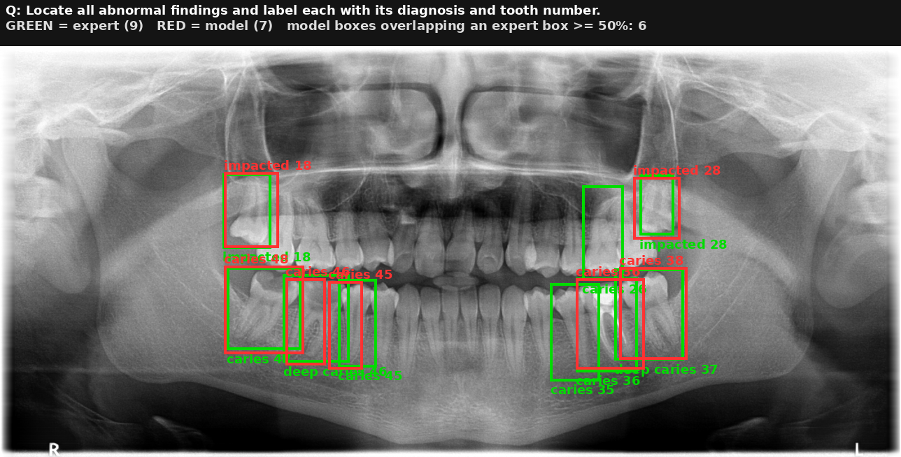
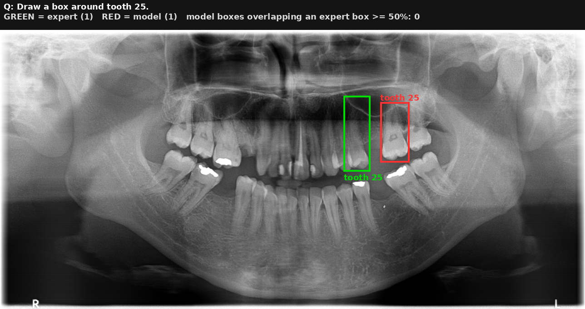
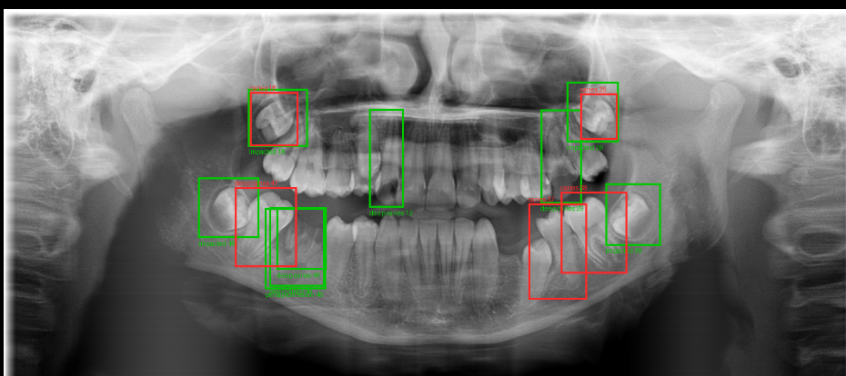

# Dental Specialist: Grounded VQA for Panoramic Dental X-rays with an RL Critic

The dental arm of the project *"Grounded Multi-Agent Multimodal VQA for MSK and Dental Radiographs with a
Reinforcement-Learned Critic"*.

## Project description

Dentists read many panoramic X-rays a day, and small findings such as early or deep caries are easy to miss.
Existing AI falls into two camps: **detectors** draw boxes but cannot answer questions, and **general
vision-language models** answer questions but do not understand dental X-rays, often invent findings, and
cannot show where their answer comes from.

This project builds a **dental assistant that answers clinical questions about a panoramic X-ray, points to its
evidence, and knows when to defer to a dentist**. It covers the dental part of the project synopsis:

- a **hierarchical VQA benchmark** built from the expert-labelled DENTEX dataset: presence → localisation →
  severity → grounding → report, plus trick questions about missing teeth (~33,000 training questions,
  3,578 test questions);
- a **fine-tuned specialist**: Qwen2.5-VL-3B adapted with LoRA (0.8% of its weights trained) to answer in
  words and with **boxes** labelled by diagnosis and FDI tooth number;
- **tools**: YOLOv8m tooth-numbering and disease detectors, and a ConvNeXt-Tiny classifier that inspects one
  tooth at a time;
- an **RL critic** (PPO) that checks every answer and chooses to **accept** it, **re-ground** it with the YOLO
  boxes, **re-route** it to the tooth classifier, or **abstain**;
- **reliability tests**: no-image and swapped-image controls, hallucination on missing teeth, and an
  anatomical consistency score (is the box in the part of the mouth the answer names?).

```
X-ray + question ──► Qwen2.5-VL-3B + LoRA ──► answer + boxes
                                                  │
                     YOLO detectors ──────────────┤  (alternative answer)
                     tooth classifier ────────────┤  (second opinion)
                                                  ▼
                                   RL critic (PPO): Accept / Reground / Reroute / Abstain
                                                  ▼
                              final answer + evidence, or "refer to a dentist"
```

> Research prototype for teaching purposes, **not a medical device**. Do not use it for clinical decisions.

---

## Results (held-out DENTEX test split, 3,578 questions)

| Measure | This model (v1) | Plain Qwen2.5-VL-3B | LLaVA-Med v1.5 |
| --- | --- | --- | --- |
| Closed-question accuracy | **62.9%** | 20.3% | 35.5% |
| Presence / localisation / severity accuracy | **79.2 / 49.0 / 77.8%** | 35.0 / 13.5 / 15.7% | 49.6 / 26.4 / 39.1% |
| Hallucination on missing teeth (lower is better) | **10.4%** | 92.2% | 100% |
| Box IoU, "find all findings" | **0.65** | 0.16 | 0 |
| Boxes in the named quadrant (ACS) | **98.2%** | 27.0% | 21.9% |
| Image-reliance gap (image vs no image) | **+6.6 pts** | −9.6 pts | −1.8 pts |

| Critic (test split) | Correct overall | Answers given | Correct when answered | Hallucination |
| --- | --- | --- | --- | --- |
| No critic | 58.4% | 100% | 58.4% | 10.4% |
| Hand-written rule | 50.1% | 69.0% | 72.5% | 7.8% |
| PPO critic | 64.7% | 78.5% | 82.4% | 1.3% |
| **PPO critic + tooth classifier as Reroute** | **69.5%** | **84.5%** | **82.3%** | **1.3%** |

| Tooth classifier (3,210 test teeth) | Caries | Deep caries | Periapical lesion | Impacted |
| --- | --- | --- | --- | --- |
| AUROC | 0.86 | 0.92 | 0.94 | 0.99 |
| Recall | 58% | 54% | 42% | 92% |

### Discussion

- **Fine-tuning is what makes dental VQA work.** Plain Qwen and LLaVA-Med score far lower, and both do as well or
  better *without* the image, so they answer from the wording rather than the X-ray. The fine-tuned model loses
  6.6 points without the image and 7.1 points with another patient's image: it genuinely reads the X-ray.
- **It rarely invents findings.** On questions about teeth that are not there, it hallucinates 10% of the time
  versus 92-100% for the baselines, which matters most for a clinical assistant.
- **Grounding works at the region level, less at the tooth level.** 98% of its boxes fall in the correct
  quadrant, but only about a third of single-tooth boxes hit the exact tooth: half of the misses are exactly one
  tooth off (a counting error, not a random one).
- **Common findings are learned, rare ones are not.** Caries (94.7%) and impacted teeth (80.7%) are detected
  well. The model always answers "not deep" for caries depth and "no" for periapical lesions, so its severity score
  only reflects that most caries are not deep. This is class imbalance in DENTEX.
- **Tools and the critic make the system safer.** The critic replaces unreliable boxes with YOLO's (single-tooth
  box accuracy rises from 40% to 87%) and abstains when the sources disagree, raising accuracy on the answers it
  gives from 58% to 82%. The tooth classifier, which inspects one tooth at a time, catches about half of the deep
  caries and periapical lesions the main model misses, and as a second opinion lets the critic answer 6% more
  questions at the same accuracy.
- **Remaining issues:** re-grounding with YOLO also brings in some false caries boxes (its confidence threshold
  can be tuned with `19_tune_detector_threshold.py`), the critic still rarely chooses the classifier, and free-text
  reports are weak because the training report question had two answer styles.

---

## Examples

Green boxes are the dentist's labels (DENTEX); red boxes are the model's answer.

**Correct: both impacted wisdom teeth found, with the right diagnosis and tooth numbers.**



**Correct: "Locate tooth 44".**



**Mostly correct: 6 of 7 boxes match an expert finding on a multi-finding X-ray.**



**Near miss: "Draw a box around tooth 25" boxes the neighbouring tooth (the most common error).**



**Failure: impacted wisdom teeth found in the right place but labelled caries; deep caries missed.**



**Live system example** (`18_live_critic.py`, test X-ray with deep caries on tooth 48):

| Question | Model alone | YOLO | Tooth classifier | Critic | Final |
| --- | --- | --- | --- | --- | --- |
| Is there deep caries? | No ✗ | Yes | Yes | Reground → Accept | **Yes** ✓ |
| Which teeth have caries? | 17, 25, 26, 36, 37, 46, 47 ✗ | 18, 48 | 16, 18, 28, 36, 37, 38, 48 | Abstain | **Refer to a dentist** |
| Locate all abnormal findings | Boxes on 36, 37, 38 ✗ (wrong side) | Deep caries 48, caries 18 | — | Reground → Accept | **Deep caries 48, caries 18** ✓ (misses caries 28) |

Across three live test X-rays with deep caries, the model alone said "yes" once; the full system said "yes" on all
three by switching to the tools, and abstained where all sources disagreed.

---

## What's in this repository

```
dental/                  core code: prompts, answer parsing, specialist wrapper, RL critic, metrics
scripts/                 every step, numbered in order (data -> training -> evaluation -> critic -> live)
configs/dental_config.yaml   settings (base model, image size, training)
cluster/                 SLURM job files used on the NTU EEE GPU cluster
outputs/dental_lora_3b/final/        the fine-tuned model (LoRA adapter, v1)
outputs/tooth_classifier/best.pt     tooth-crop classifier (ConvNeXt-Tiny)
runs/detect/outputs/dentex_disease_yolo/weights/best.pt        YOLOv8m disease detector
runs/detect/outputs/dentex_enumeration_yolo/weights/best.pt    YOLOv8m tooth-numbering detector
results/                 result files (scores, error analysis, trained critics)
```

The **base model** (Qwen2.5-VL-3B-Instruct, ~7 GB) is not stored here. It downloads automatically from
Hugging Face the first time the code runs. The **DENTEX images are not included**; see "Training from scratch".

> `outputs/` and `runs/` are not stored in the repository itself (too large for GitHub). Download
> `outputs.zip` (release **v1.0**) and `runs.zip` (release **v1.0-yolo**) from the **Releases** page and unzip
> both into the repository folder.

---

## Setup

Needs Python 3.10+ and an **NVIDIA GPU with at least 12-16 GB** of memory (CPU-only is far too slow).

```bash
git clone https://github.com/<your-username>/<repo-name>.git
cd <repo-name>

# 1) PyTorch with GPU support: use the command from https://pytorch.org for your CUDA version, e.g.
pip install torch torchvision --index-url https://download.pytorch.org/whl/cu121

# 2) everything else
pip install -r requirements.txt
```

`requirements.txt` must include `ultralytics`, `torchvision` and (for a GUI) `gradio`.

```bash
# 3) trained weights (too large for the repository itself)
#    outputs.zip from release v1.0       -> outputs/dental_lora_3b/final/, outputs/tooth_classifier/best.pt
#    runs.zip    from release v1.0-yolo  -> runs/detect/outputs/.../weights/best.pt (two YOLO detectors)
#    Download both from this repository's Releases page and unzip them into the repository folder.
```

Optional: download the base model in advance
```bash
pip install huggingface_hub
hf download Qwen/Qwen2.5-VL-3B-Instruct
```

---

## Run it

### Full system (model + YOLO tools + tooth classifier + RL critic)

```bash
python scripts/18_live_critic.py --image path/to/panoramic_xray.png \
  --question "Is there deep caries in this panoramic radiograph?" \
  --question "Locate all abnormal findings and label each with its diagnosis and tooth number."
```

For each question the terminal shows the model's answer, the YOLO and classifier answers, the critic's decisions
and the **final answer** (or "not sure - refer to a dentist"). A picture with the final boxes in **red** is saved
to `results/live/`. Without `--question`, four default questions are asked.

### The model alone (no critic)

```bash
python scripts/10_ask.py --image path/to/panoramic_xray.png --question "Is there caries?"
```

Pictures go to `results/ask/`.

### From your own code (e.g. a GUI)

`dental/api.py` wraps the whole system in one object. Models load once; each question then takes a few seconds.

```python
from dental.api import DentalSystem, EXAMPLE_QUESTIONS

system = DentalSystem()                      # run from the repository folder; needs a GPU
r = system.ask("xray.png", "Is there deep caries in this panoramic radiograph?")   # path or PIL image

r["final_answer"]      # e.g. "Yes."  or "Not sure - please have a dentist check this."
r["abstained"]         # True if the critic referred it to a dentist
r["final_source"]      # "specialist", "YOLO tools" or "tooth classifier"
r["critic_actions"]    # e.g. ["reground", "accept"]
r["specialist"], r["yolo"], r["classifier"]   # what each part answered (None if not applicable)
r["final_boxes_original"]   # [{"box": [x1, y1, x2, y2], "label": "deep caries 48"}, ...] in the uploaded image's pixels
r["image"]             # PIL image with the final boxes drawn in red
```

`EXAMPLE_QUESTIONS` lists questions the system handles well (useful as clickable examples in a GUI). Report
questions and other free questions are answered by the specialist alone (`r["critic_used"]` is False).

---

## Which questions work

The model was trained on these kinds of questions (use FDI tooth numbers 11-48 and the four diagnoses:
**caries, deep caries, periapical lesion, impacted**):

| Type | Example |
| --- | --- |
| Presence | "Is there caries?" / "Is there an impacted tooth?" |
| Which teeth / quadrants | "Which teeth have caries? Give FDI numbers." / "In which quadrant is the impacted tooth?" |
| Finding on a tooth | "What is the finding on tooth 46?" |
| Severity | "Is the caries on tooth 36 deep or not deep?" |
| Tooth present | "Is tooth 18 present?" |
| Counting | "How many teeth are in quadrant 3?" |
| Boxes | "Locate all impacted teeth and output bounding boxes." / "Draw a box around tooth 43." |
| Report (no critic) | "Write a short radiology report for this panoramic X-ray." |

Questions about other findings (fillings, implants, bone loss), treatment advice, or other X-ray types
(bitewing, periapical films, photos) are outside what it learned; answers to them are unreliable.

---

## Training from scratch (what the scripts do)

Run from the repository folder. On the NTU cluster each step has a job file in `cluster/` (`sbatch cluster/<name>.sbatch`).

| Step | Script | What it does |
| --- | --- | --- |
| 1 | `00_inspect_dataset.py`, `01_prepare_dentex.py` | Read DENTEX (download from Hugging Face: `ibrahimhamamci/DENTEX`) into `data/raw/DENTEX` |
| 2 | `03_make_splits.py` | Split labelled X-rays by image into train / val / test (70/15/15) |
| 3 | `04_generate_vqa.py` | Generate the hierarchical questions (presence, localisation, severity, grounding, report, absent-tooth) |
| 4 | `05_finetune_lora.py` | LoRA fine-tune Qwen2.5-VL-3B (rank 16, 1 epoch, ~15 h on one A40) |
| 5 | `06_predict.py`, `07_metrics.py` | Answer the test set (with image / no image / swapped image) and score it |
| 6 | `09_train_detector.py` | Train the YOLOv8m disease and tooth-numbering detectors |
| 7 | `11_predict_llavamed.py` | LLaVA-Med baseline |
| 8 | `12_draw_predictions.py` | Draw model (red) vs expert (green) boxes |
| 9 | `13_collect_rollouts.py` | Record the model's answers + detector outputs for the critic |
| 10 | `14_train_critic.py` | Train and compare critics (no critic, rules, supervised, PPO) |
| 11 | `15_error_analysis.py` | Count every error type over the whole test set |
| 12 | `16_train_tooth_classifier.py`, `17_reroute_with_classifier.py` | Tooth-crop classifier and its Reroute answers |
| 13 | `19_tune_detector_threshold.py` | Choose the YOLO confidence threshold on validation data |
| 14 | `18_live_critic.py` | The live pipeline |

---

## Data and licences

- **DENTEX** (Hamamci et al., 2023) provides the X-rays and expert labels. Images are not redistributed here;
  download them from the official source and follow its licence. The example figures in `docs/images/` show
  DENTEX test X-rays with expert and model boxes, for illustration with credit to the DENTEX authors.
- **Qwen2.5-VL** is downloaded from Hugging Face under its own licence.
- **Ultralytics YOLO** is AGPL-3.0.

## Limitations

- Evaluated on our own held-out split of DENTEX, not the official DENTEX test set or MMOral-Bench.
- Questions and reports are generated from labels with templates, not written by clinicians.
- One training run (one seed); the critic was trained on recorded answers (offline).
- Gaze alignment with dentists' eye-tracking (Tufts Dental Database) is future work.
